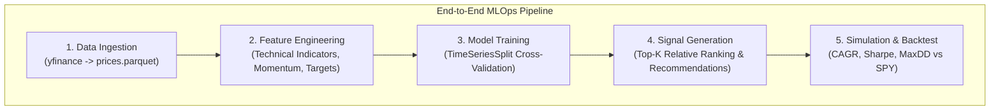

# Sector Rotation Strategy with Machine Learning & MLOps Dashboard

A machine learning-driven quantitative trading framework designed to implement an algorithmic sector rotation strategy across US sector ETFs (`XLK`, `XLF`, `XLV`, `XLE`, `XLI`, `XLP`, `XLY`, `XLU`, `XLB`, `XLRE`, `XLC`) using `yfinance`,
with an interactive web-based MLOps dashboard powered by **FastAPI**, **Nginx**, and **Docker**.

[](https://www.python.org/)
[](https://fastapi.tiangolo.com/)
[](https://lightgbm.readthedocs.io/)
[](https://cloud.yandex.ru/)

---

## Project Overview

The objective of this project is to build an end-to-end algorithmic trading workflow that dynamically rotates capital into the top-performing US economic sector ETFs based on Machine Learning predictions, managed via an intuitive modular
web dashboard.

### Key Pipeline Components:
1. **Data Ingestion**: Automated ingestion of historical daily market data via `yfinance` into Parquet and SQLite storage, complete with dataset preview and metadata summaries.
2. **Feature Engineering**: Multi-period momentum indicators (1M, 3M, 6M), technical indicators (RSI, MACD, Moving Averages), and volatility metrics.
3. **Machine Learning Modeling**: Predictive classification and regression models trained via time-series cross-validation (`TimeSeriesSplit`).
4. **Signal Generation**: Top-K relative ranking algorithm selecting the top $K$ sectors for equal-weighted portfolio allocation, generating actionable trading recommendations.
5. **Backtesting Engine**: Vectorized and event-driven backtesting simulating transaction fees, slippage, rebalancing frequency, and performance benchmarking against the broad S&P 500 index (`SPY`).
6. **Automation & MLOps UI**: Modular web dashboard (`FastAPI` + `Nginx`) packaged into a single container for seamless step-by-step pipeline execution and monitoring.

---

## Architecture & Data Workflow



---

## Repository Structure

```text
stock_markets_analytics_26/
├── .github/
│   └── workflows/
│       └── deploy.ym              # CI: Deploy to Yandex Cloud Serverless Containers
├── tf-bootstrap/                  # Terraform infrastructure provisioning
│   ├── outputs.tf                 # Output variables (registry_id, sa_id)
│   ├── provider.tf                # Yandex Cloud provider configuration
│   ├── registry.tf                # Container Registry setup
│   ├── sa.tf                      # Service accounts and IAM permissions
│   └── variables.tf               # Input variable definitions
├── frontend/
│   ├── index.html                 # Interactive MLOps web dashboard
│   └── default.conf               # Nginx reverse proxy configuration
├── src/                           # Main source code package
│   ├── config.py                  # Central settings and environment variables
│   ├── data/                      # Ingestion module (ingest.py)
│   ├── features/                  # Technical indicator engineering (build_features.py)
│   ├── models/                    # Model architecture and trainer modules (train.py)
│   ├── strategy/                  # Signal ranking algorithms (generate_signals.py)
│   ├── backtest/                  # Simulation metrics and backtesters (simulator.py)
│   ├── app/                       # FastAPI backend orchestrators (api.py)
│   └── utils/                     # Database and file I/O utilities (io.py)
├── data/                          # Data storage (gitignored)
├── models/                        # Saved machine learning artifacts (.joblib)
├── reports/                       # Visual plots and summary markdown reports
├── Dockerfile                     # Single-container image (Nginx + FastAPI + entrypoint)
├── entrypoint.sh                  # Container startup script for Nginx and FastAPI
├── Makefile                       # Command shortcut runners
├── requirements.txt               # Dependency list
└── README.md                      # Project documentation
```

## Getting Started & Local Setup

### Prerequisites
- **Python 3.14** or higher
- **`uv`** (Fast Python package manager)
- **Docker** (For local containerized deployment)

### Option A: Running via Docker Container Locally 

1. **Clone the repository:**
   ```bash
   git clone https://github.com/petr-akimov/stock_markets_analytics_26.git
   cd stock_markets_analytics_26
   ```

2. **Build the Docker image and Run the Container:**

```
docker build -t sector-ml-app:latest .
docker run --rm -p 8080:8080 sector-ml-app:latest
```

Open http://localhost:8080 in your browser to access the interactive MLOps dashboard.

### Option B: Cloud Deployment (Yandex Serverless Containers - Manual)

1. **Clone the repository:**
   ```bash
   git clone https://github.com/petr-akimov/stock_markets_analytics_26.git
   cd stock_markets_analytics_26
   ```

2. **Run GitHub Actions Manually**
   Open GHA Deploy Yandex Serverless Container Manually and Run Workflow

## Execution Workflow (Makefile Commands)

You can run the entire pipeline sequentially using the provided `Makefile` shortcuts:

| Command | Description |
| :--- | :--- |
| `make ingest` | Download historical market data via `yfinance` and persist to Parquet/SQLite. |
| `make features` | Generate technical indicators, momentum returns, volatility, and target variables. |
| `make train` | Train the ML model using `TimeSeriesSplit` cross-validation and save artifacts. |
| `make signals` | Generate relative ranking signals (`Top-K` sectors allocation). |
| `make backtest` | Run the portfolio backtest simulator and evaluate performance metrics. |

---

## Backtest Performance & Results

The algorithmic sector rotation strategy is evaluated against the broad market benchmark (`SPY`).

- **CAGR (Annualized Return):** `13.88%`
- **Sharpe Ratio:** `0.80`
- **Max Drawdown:** `-45.36%`

Detailed performance reports, equity curves, and drawdown charts are saved under `data/backtests/` and `reports/`.

---

## Formalized Action Matrix: Input, Output, and Rationale

| Pipeline Stage | Input Data (What goes in) | Action & Transformation | Target Artifact / Output (What is produced) | Rationale & Logic (Why it is done) |
| :--- | :--- | :--- | :--- | :--- |
| **1. Ingestion** (`make ingest`) | Raw API responses from Yahoo Finance for sector ETFs (`XLK`, `XLF`, `XLV`, etc.) & benchmark (`SPY`). | Fetch, normalize column names, align timestamps, and serialize into compressed tabular storage. | `data/processed/prices.parquet` | Convert unstructured raw timeseries into an optimized columnar `Parquet` format for fast reads, efficient memory usage, and zero data duplication. |
| **2. Feature Engineering** (`make features`) | Processed prices table (`prices.parquet`). | Compute rolling technical indicators (`SMA`, `EMA`, `RSI`, `MACD`), historical momentum, volatility, and define forward-looking regression/classification targets. | `data/analytics/features.parquet` | Extract quantitative features to capture market trends, volatility regimes, and overbought/oversold conditions while setting up supervised learning labels. |
| **3. Model Training** (`make train`) | Feature matrix from `features.parquet`. | Fit ensemble algorithms using strict time-series cross-validation (`TimeSeriesSplit`). | `models/sector_rf_model.joblib` | Train predictive models without look-ahead bias (*data leakage*), ensuring robust generalization on future unseen market data. |
| **4. Signal Generation** (`make signals`) | Model inference scores and historical asset identifiers. | Rank sector predictions on each trading date, apply a `Top-K` threshold, and compute portfolio allocation weights. | `data/signals/signals.parquet` | Translate probabilistic model outputs into actionable, equal-weighted portfolio target allocations and forward-looking trading recommendations. |
| **5. Backtesting** (`make backtest`) | Ranked signals (`signals.parquet`) and historical asset prices (`prices.parquet`). | Simulate portfolio rebalancing, track equity curves, compute benchmark comparisons against `SPY`, and evaluate risk metrics. | `data/backtests/summary.json`<br>`data/backtests/equity.parquet` | Quantify strategy performance (achieving 13.88% CAGR and 0.80 Sharpe ratio) to validate economic viability before live deployment. |

---

## User Interface Sector Rotation Strategy MLOps

 <br>

---

## Evaluation Criteria Compliance Matrix

| Criteria | Points Claimed | Supporting Artifacts & Implementation Details |
| :--- | :---: | :--- |
| **Problem Description** | **2 / 2** | Detailed description of the quantitative sector rotation problem, economic rationale, and end goals. |
| **Data Sources** | **1 / 1** | Automated ingestion of US sector ETFs (`XLK`, `XLF`, `XLV`, `XLE`, `XLI`, `XLP`, `XLY`, `XLU`, `XLB`, `XLRE`, `XLC`) and `SPY` via `yfinance`. |
| **Data Transformations + EDA** | **2 / 2** | Unified dataset combining multi-source ETF prices, feature sets definition, technical indicators (`RSI`, `MACD`, `SMA`, `EMA`), and momentum/volatility metrics. |
| **Modeling** | **2 / 2** | Supervised classification/regression models trained via Time-Series Cross-Validation (`TimeSeriesSplit`) with saved model artifacts in `models/`. |
| **Trading Simulation** | **5 / 5** | Vectorized and simulation backtests computing CAGR (`13.88%`), Sharpe ratio (`0.80`), Max Drawdown (`-45.36%`), and performance benchmarking against `SPY`. |
| **Automation & MLOps** | **3 / 3** | Modular `.py` scripts orchestrated via `Makefile`, FastAPI backend, and fully containerized multi-service deployment both via Docker and Yandex Cloud`. |
| **Bonus Points** | **5 / 5** | Production-ready clean modular architecture, interactive web-based MLOps dashboard (Nginx + FastAPI), rich execution summaries, and robust Serverless Container support in Yandex Cloud. |